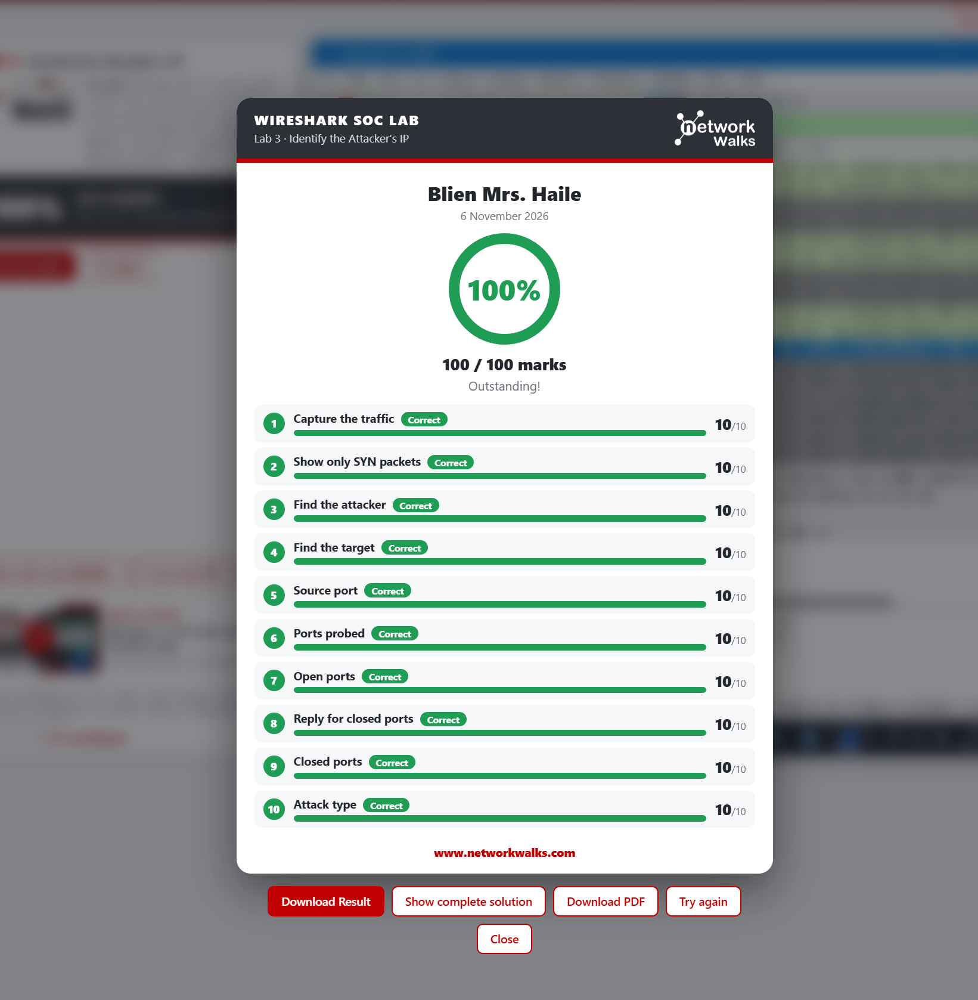
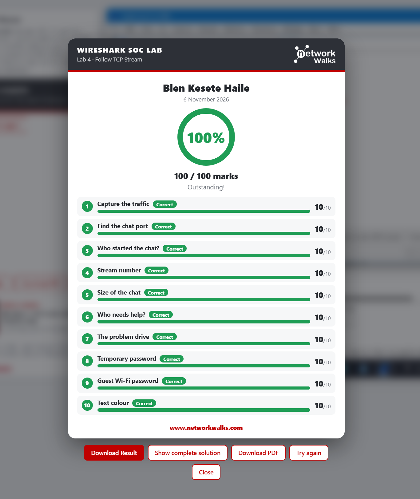
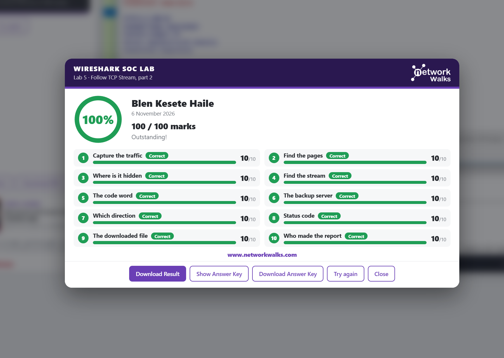
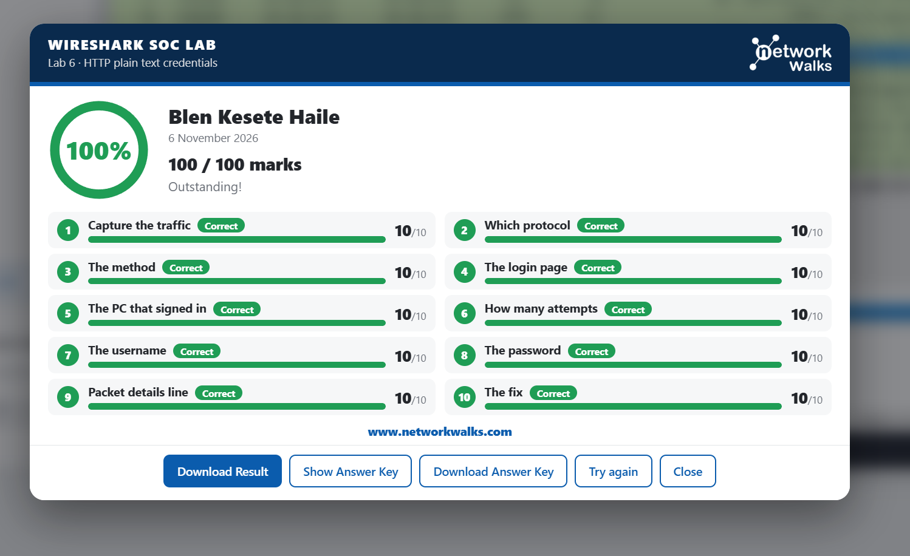
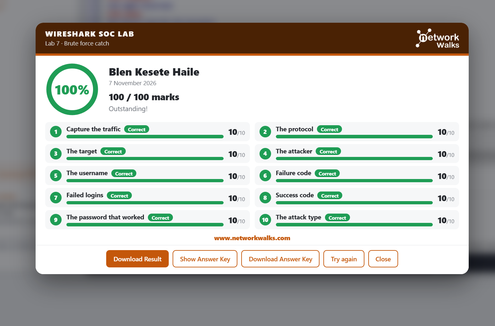
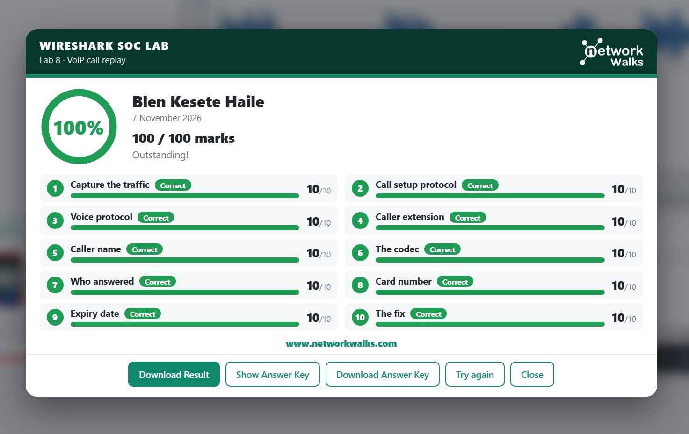

# Wireshark SOC Lab

## Project Overview

I completed Labs 3–8 of the Network Walks Wireshark SOC Lab to practice investigating network traffic. I used packet details, TCP streams, and protocol responses to identify what happened in each exercise.

## Lab Components

- Wireshark for packet analysis
- Network Walks SOC Lab exercises and lab traffic
- Result screenshots for each completed exercise

## Step 1 — Identify the Attacker’s IP (Lab 3)

1. I captured the lab traffic and filtered for TCP SYN packets.
2. I checked the source and destination to identify the scanning host and its target.
3. I recorded the source port and the destination ports that were probed.
4. I compared the target’s replies to distinguish open ports from closed ports and identify the scan.

**Result:** 100/100.

## Step 2 — Follow a TCP Chat Stream (Lab 4)

1. I captured the lab traffic and found the port used by the chat.
2. I identified who started the conversation and followed the TCP stream to read it in order.
3. I checked the stream number and size, then identified who needed help and which drive was affected.
4. I found a temporary password and a guest Wi-Fi password in the conversation.

**Result:** 100/100.

## Step 3 — Follow a Web Traffic Stream (Lab 5)

1. I captured the traffic, located the relevant pages, and followed the TCP stream.
2. I inspected the conversation to find the hidden code word and identify the backup server.
3. I checked the direction of the transfer and the HTTP status code.
4. I identified the downloaded file and who made the report.

**Result:** 100/100.

## Step 4 — Inspect a Plaintext HTTP Login (Lab 6)

1. I captured the login traffic and identified the HTTP request method and login page.
2. I identified the PC that sent the requests and counted the login attempts.
3. I inspected the login request in the packet details and found the submitted username and password.
4. I identified HTTPS as the fix for exposing credentials in transit over plain HTTP.

**Result:** 100/100.

## Step 5 — Investigate a Brute-Force Login (Lab 7)

1. I captured the lab traffic and identified the protocol, attacker, target, and username.
2. I identified the failure response code and counted the failed login attempts.
3. I located the success response and matched it to the attempt that worked.
4. I used the sequence of failed attempts followed by a success to classify the attack.

**Result:** 100/100.

## Step 6 — Replay a VoIP Call (Lab 8)

1. I captured the call traffic and identified the protocols used for call setup and voice.
2. I checked the caller’s name and extension, who answered, and which audio codec the call used.
3. I replayed the lab call and identified the payment details spoken during it.
4. I identified the need to protect the voice stream with encryption.

**Result:** 100/100.

## What I Learned

Following a TCP stream helped me reconstruct conversations that were split across packets. Comparing requests and responses helped me tell a failed login from a successful one. The chat, HTTP, and VoIP exercises also showed how sensitive information can be exposed when it travels without encryption.

The screenshots show the graded results. The packet captures would provide the exact request methods, response codes, and packet order. Server code or documentation would be needed to trace password verification, storage, and any session tokens.

Training exercises by [Network Walks](https://www.networkwalks.com/).
